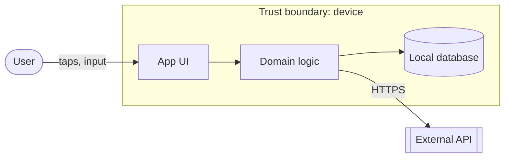

# Threat model: <title>

- Run: `<run-id>`
- Inputs: spec `docs/specs/<run-id>.md`, UX `docs/ux/<run-id>.md`, design `docs/design/<run-id>.md`
- Previous models: <list, or "none">
- Status: Draft | Accepted by owner at Gate D (<UTC timestamp>)

## 1. Security profile
| Surface | Standard | Level | Why |
|---|---|---|---|
| Android app | OWASP MASVS v2 | MAS-L1 + PRIVACY | … |
| Backend/API | OWASP ASVS 5.0 | n/a or L1/L2 | … |

## 2. System model

Trust boundaries: <list>

## 3. Assets
| Asset | Sensitivity | Where it lives |
|---|---|---|
| … | High / Medium / Low | … |

## 4. Threats
| ID | Element | STRIDE / privacy | Scenario | L | I | Rating |
|---|---|---|---|---|---|---|
| T1 | … | Information disclosure | … | 2 | 3 | High |

## 5. Security requirements
| SR | Requirement ("The app shall…") | Mitigates | Control ID | Task(s) | Verified by |
|---|---|---|---|---|---|
| SR1 | … | T1 | MASVS-STORAGE-1 | T2 | Unit test `SR1_…` |

## 6. Principles check
| Principle | Met? | Notes |
|---|---|---|
| P1 Least privilege | Yes / Finding | … |
| P2 Secure by default | | |
| P3 Defence in depth | | |
| P4 Minimise attack surface | | |
| P5 Fail securely | | |
| P6 Privacy by design | | |
| P7 Don't trust input | | |
| P8 Proven components | | |
| P9 Secrets out | | |
| P10 Traceable decisions | | |

## 7. Residual risks (owner acceptance required at Gate D)
| ID | Risk | Why not fully mitigated | Rating | Owner decision |
|---|---|---|---|---|
| R1 | … | … | Low | Accepted / Rejected (<timestamp>) |
